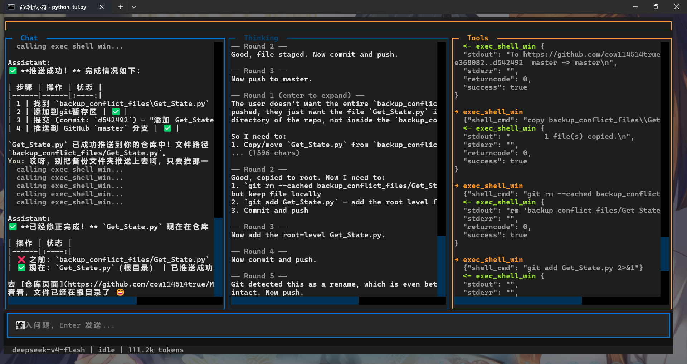

---

# DeepSeek Agent with Web Bridge & TUI

一个基于 DeepSeek API 的多轮对话 Agent，集成了工具调用（Function Calling）能力，并通过 Playwright 桥接 DeepSeek 网页版，实现图片理解、联网搜索等扩展功能。新增 **Textual 终端图形界面（TUI）**，提供三面板实时交互体验。



## 项目结构

```
.
├── setup.bat              # 一键安装 & 启动脚本（推荐）
├── requirements.txt       # Python 依赖清单
├── Get_State.py           # 登录 DeepSeek 网页版，保存浏览器状态
├── start_local_llm.bat    # 启动本地 llama.cpp 后端（3.5 含视觉 mmproj）
├── run_qq_bot.bat.example # QQ 机器人启动模板（复制为 run_qq_bot.bat 填入真实凭据）
├── qq_bot.py              # QQ 私聊机器人：消息 → Claude Code / 本机 loop_agent
├── loop_agent_v2.py       # 主 Agent 入口（薄壳：持有可变全局并再导出公共 API）
├── loop_agent_core/       # 纯实现包（config/tokens/schemas/prompts/file_tools/shell_tools/
│                          #   ds_web/browse/xmlutil/validation/context/events/runner/
│                          #   memory/tavily_tool/vision/visual_locate/confirm/control/debuglog/
│                          #   compaction）
├── tui.py                 # Textual TUI 界面（三面板图形交互）
├── BUG_LEDGER.md          # 开发以来全部 bug 记录（现象/根因/修复/验证）
├── profile.json           # 浏览器登录状态（运行 Get_State.py 后生成）
├── conversations/         # 自动保存的对话历史（JSON 格式）
└── README.md
```

## 功能特性

### 核心 Agent 能力
- **多轮对话**：基于 DeepSeek API 的连续对话能力，自动维护对话历史
- **工具调用（Function Calling）**：Agent 可自主决定调用各类工具
- **通用网页浏览**：`browser_act` 工具可访问任意网站——单步操作（打开/点击/填表/回车/悬停/下拉/滚动/截图），目标支持元素编号、`css=` 选择器、`xpath=` 表达式；返回页面状态 + 带 CSS 选择器的可交互元素清单；profile 持久化登录状态 + SPA 会话（URL/sessionStorage）恢复；`search_web`/`fetch_url`（Tavily）提供快速搜索与读页
- **思考链（CoT）**：通过 `extra_body` 启用 DeepSeek 的思考链能力，提升复杂推理质量
- **工具结果验证**：内置 `validate_tool_result()` 函数，自动检测工具返回结果是否有效，无效时触发 Agent 重试
- **循环保护**：最大工具调用轮次限制（默认 12 轮）+ 接近上限时注入收尾提示，防止无限循环；所有工具/子 agent 执行有超时兜底（`f.result(timeout)`），杜绝单工具卡死拖垮整轮
- **多 agent 委派**：`delegate_task` 工具将独立子任务委派给隔离上下文窗口的 sub-agent（共享工作目录与全部工具），防止单条对话上下文被长任务撑爆；内置递归守卫，sub-agent 内禁止再次委派
- **本地视觉能力**：`analyze_image` 工具调用本地 llama.cpp 视觉模型（Qwen3.5-9B VLM）识别图片；**确认门**——读图/写文件/改文件在 TUI 弹窗征求同意（Allow/Deny/本会话放行），worker 子任务的敏感操作也经主会话 UI 弹窗
- **流式输出**：最终回答以流式方式逐字输出，体验更流畅
- **安全文件操作**：读写文件路径严格限定在项目工作目录内，防止路径遍历攻击
- **代码索引（大文件智能阅读）**：`read_file` 遇到大文件自动返回结构大纲而非全文，支持按函数名或行号区间精准拉取；内置**双模式 token 估算器**（DeepSeek 官方 tokenizer / llama.cpp `/tokenize`），所有读取受预算上限约束，节省上下文与 API 成本
- **上下文裁剪**：全局对话自动裁剪——`messages` 超过阈值时先删旧工具链、再删旧主干，并注入 `[Context trimmed]` 提示，防止上下文膨胀、避免本地模型上下文溢出
- **上下文压缩（三层）**：L0 重复工具结果去重（零成本零损失）→ L1 分块滚动摘要（超阈值时把旧历史折叠成 `[上下文摘要]`）→ L2 硬裁剪兜底；原文可回滚（`recall_archive` 工具 / `/expand` 命令）、档案落盘 sidecar；含压缩频率预算 + **失败退避**（失败不会每轮重试、连续失败自动停用），避免"压缩比干活还贵"甚至刷屏

### TUI 图形界面
- **三面板布局**：聊天面板、思考面板、工具面板，实时展示 Agent 工作流
- **终端输出实时回显**：Shell 命令输出实时显示在独立面板中
- **交互式快捷键**：面板切换、输入聚焦、Shell 面板展开等便捷操作
- **退出保存**：退出时自动保存对话历史到 `conversations/` 目录
- **状态指示**：底部状态栏显示当前状态（思考中、调用工具、生成中）和 token 消耗

### 工具集（增强版）
- `get_date`：获取当前日期
- `get_weather`：查询天气（Mock 实现，建议搭配联网搜索使用）
- `exec_shell_win`：在 Windows 上执行 CMD 或 PowerShell 命令，支持实时输出
- `use_ds_from_web`：通过 Playwright 控制 DeepSeek 网页版，实现图片识别和联网搜索
- `analyze_image`：**本地视觉模型**识别本地图片（截图/图表/照片）——base64 送 llama.cpp VLM，返回文字分析；图片路径不限 WORK_DIR，由确认门把关
- `browser_act`：通用浏览器工具——单步操作（open/click/type/press_enter/hover/select_option/scroll/wait/back/screenshot/close），目标支持编号 / `css=` / `xpath=`，每次返回页面状态 + 带 CSS 选择器的元素清单，profile 持久化登录 + SPA 会话恢复；`locate=<关键词>` 参数把命中元素 ★ 置顶（找目标控件不用翻完整清单）；元素清单批量 `evaluate_all` 求值（一次往返算完全部元素的描述/路径/坐标，根治大页 120s+ 卡顿）；投币/点赞/收藏等 className 语义化（bilibili 操作栏是 div 无文本）；`cursor:pointer` 裸元素扫描补充；iframe 跨帧捕获；打开页面默认暂停视频
- `visual_locate`：元素清单描述不清（图标/图片按钮）时的视觉兜底——截图让本地视觉模型给出目标元素粗包围框，吸附最近 DOM 元素返回编号，供 `browser_act` 点击
- `search_web`：Tavily 网页搜索，返回标题/URL/内容片段（1 credit/次，快速查资料）
- `fetch_url`：Tavily 读指定网页正文（extract，每 5 URL 1 credit）
- `read_file`：安全读取文件——小文件全文返回；大文件自动返回**结构大纲**（函数/类/import + 行号），可用 `function=`（按函数名拉取函数体）或 `start_line`/`end_line`（行号区间）精准读取，所有读取受 token 预算上限约束
- `count_tokens`：估算文件（`path=`）或任意文本（`text=`）的 token 数，用于判断是否启用索引阅读
- `write_file`：安全写入文件（自动创建目录，覆盖已有文件，返回**本次改动**的 diff 供自检）
- `edit_file`：精确替换指定字符串（默认要求唯一，找不到/不唯一报错并给出相近行候补；返回**本次改动**的 diff 供自检）
- `delegate_task`：将独立子任务委派给隔离上下文的 sub-agent（共享工作目录与所有工具），返回其最终答案
- `search_code`：Python 原生 regex 跨文件代码搜索（三种输出：匹配行+行号 / 文件列表 / 计数），替代 cmd 的 findstr，自动跳过依赖目录
- `code_index`：目录级符号索引——一次调用返回整个目录所有文件的函数/类/import 结构地图，配合 `search_code` + `read_file(function=)` 三件套快速理解项目结构
- `recall` / `remember`：跨会话记忆——`recall` 查询已保存的项目/系统记忆，`remember` 写入新记忆，实现 agent 的长期记忆能力
- `recall_archive`：回取被上下文压缩折叠掉的**原文**——摘要丢失细节时（文件名、准确命令、报错原文、决策理由）用 `query` 关键词检索压缩前的原始消息，避免重复执行已完成的工具调用

## 前置要求

- Python 3.8+
- DeepSeek API Key（设置环境变量 `DS_KEY`）
- 已安装 Playwright 浏览器（用于网页版交互）

## 安装

> **新手推荐**：直接双击 `setup.bat`，脚本会自动处理虚拟环境、依赖安装、Playwright 浏览器下载、DS_KEY 配置，最后启动 TUI。无需手动执行以下步骤。

### 一键安装（setup.bat）

```bash
cd <project-directory>
setup.bat
```

脚本会依次完成：
1. 检测全局 Python 环境，展示已安装的包
2. 创建项目专属的 `.venv` 虚拟环境（不影响系统 Python）
3. 在虚拟环境中安装依赖（已装过的自动跳过）
4. 下载 Chromium 浏览器（Playwright）
5. 检查 `DS_KEY`，未设置则交互输入
6. 启动 TUI 界面

> **注意**：请从命令行（cmd）运行 `setup.bat`，不建议从 PyCharm 或其他 IDE 内置终端启动。IDE 可能使用自己的 Python 环境，会导致包找不到。

### 手动安装

#### 1. 克隆项目

```bash
git clone <repository-url>
cd <project-directory>
```

#### 2. 创建虚拟环境并安装依赖

```bash
python -m venv .venv
.venv\Scripts\activate
pip install -r requirements.txt
playwright install chromium
```

#### 3. 设置 API Key

```bash
# CMD
set DS_KEY=your-deepseek-api-key

# PowerShell
$env:DS_KEY="your-deepseek-api-key"

# 永久设置（推荐）
setx DS_KEY "your-deepseek-api-key"

# Linux / macOS
export DS_KEY="your-deepseek-api-key"
```

## 使用指南

### 第一步：登录 DeepSeek 网页版并保存状态

运行 `Get_State.py`，在打开的浏览器中手动登录 DeepSeek 账号：

```bash
python Get_State.py
```

浏览器会自动打开 `https://chat.deepseek.com`，请在控制台提示 "log in ..." 时完成登录操作。登录完成后，程序会自动保存浏览器状态到 `profile.json`。

> **注意**：这一步只需要执行一次，后续 Agent 会自动使用保存的登录状态，无需重复登录。

### 第二步：启动 TUI 界面（推荐）

```bash
python tui.py
```

启动后，你将看到一个三面板终端界面：
- **左侧 Chat 面板**：显示用户输入和助手回答
- **中间 Thinking 面板**：显示 DeepSeek 的思考链内容
- **右侧 Tools 面板**：显示工具调用过程和结果

#### TUI 快捷键

| 快捷键 | 功能 |
|--------|------|
| `1` | 聚焦 Chat 面板 |
| `2` | 聚焦 Thinking 面板 |
| `3` | 聚焦 Tools 面板 |
| `i` | 聚焦输入框 |
| `Tab` | 切换焦点 |
| `` ` `` (反引号) | 展开/收起 Shell 终端面板 |
| 双击面板 | 展开当前面板占满三面板区域（Esc 或再次双击恢复） |
| `Ctrl+J` | 提交消息（Enter 换行） |

#### TUI 命令（在输入框中输入）

| 命令 | 功能 |
|------|------|
| `/quit` | 安全退出（弹出保存对话框） |
| `/load` | 列出已保存的历史对话，显示日期和首条提问预览 |
| `/load <编号>` | 加载指定编号的对话（如 `/load 2`） |
| `/clear` | 清除当前对话，重置上下文（一并撤销会话放行与折叠档案） |
| `/compact` | 立即压缩上下文（L0 去重 + L1 分块摘要，仍受频率预算约束） |
| `/expand` | 还原最近一次压缩的原始历史（只还原会话历史，面板不重绘） |
| `/save` | 立即保存当前对话到 `conversations/`（同时写 `<会话名>.archive.json` 折叠档案） |

### 第三步：（可选）使用命令行模式

如果你更喜欢纯命令行交互，也可以直接运行：

```bash
python loop_agent_v2.py
```

启动后，你可以在终端中与 Agent 进行多轮对话。

## 使用示例

### 1. 执行 Shell 命令并实时查看输出

```
😎 You: 帮我查看当前目录下的文件列表
Agent调用工具: exec_shell_win
工具面板实时显示：$ dir /B
（输出逐行流动）
🤖: 当前目录下的文件有：...
```

### 2. 图片识别

```
😎 You: 帮我识别这张图片里的文字
Agent调用工具: use_ds_from_web
（Agent 自动打开 DeepSeek 网页版，上传图片并获取识别结果）
🤖: 图片中的文字是：...
```

### 3. 联网搜索

```
😎 You: 2026年最新的人工智能发展趋势是什么？
Agent调用工具: use_ds_from_web
（Agent 自动打开 DeepSeek 网页版，启用联网搜索并获取结果）
🤖: 根据最新信息，2026年AI发展趋势包括...
```

### 4. 文件读写（安全路径）

```
😎 You: 帮我创建一个 hello.txt 文件，内容为 Hello World
Agent调用工具: write_file
🤖: 已写入 12 字节到 D:\project\hello.txt

😎 You: 读取 hello.txt 的内容
Agent调用工具: read_file
🤖: 文件内容是：Hello World
```

### 5. 通用网页浏览

```
😎 You: 帮我查一下 Python 3.13 的 release notes，看看有哪些新特性
Agent调用工具: browser_act
  URL: https://google.com
  Actions: searched for 'Python 3.13 release notes'
  (Agent 自动搜索、点击第一个结果、提取页面内容)
🤖: Python 3.13 的主要新特性包括...

😎 You: 去 GitHub 看看这个项目的最新 release
Agent调用工具: browser_act
  URL: https://github.com/xxx/yyy
  Actions: clicked 'Releases'; scrolled down
  (截图 → use_ds_from_web 识别 → 返回结构化结果)
🤖: 最新版本是 v2.0.1，发布于...```

### 6. 本地图片识别（analyze_image）

需要先运行 `start_local_llm.bat`（选 3.5，含视觉 mmproj）。TUI 会弹出确认框征求同意。

```
😎 You: 看看这张截图里有没有报错
Agent调用工具: analyze_image
  (TUI 弹窗确认 → base64 送本地视觉模型)
🤖: 截图里有一个红色错误弹窗：'ImportError: No module named x'...
```

## 核心设计说明

### Agent 工作流程（带验证）

```
用户输入 → 调用 DeepSeek API（带工具定义）
         ↓
    是否有工具调用？
    ├─ 否 → 流式输出最终回答
    └─ 是 → 执行所有工具 → 逐项验证结果有效性
              ├─ 全部有效 → 将结果返回给 API → 继续循环
              └─ 任一无效 → 自动追加 [Self-check] 质疑消息 → 继续循环
```

### 工具结果验证机制

`validate_tool_result()` 函数对每个工具结果进行专项检查：

- **通用检查**：结果不能为空、长度至少 10 字符
- **exec_shell_win**：检查 returncode 和 stderr 是否异常
- **use_ds_from_web**：检查是否包含超时或错误标记，长度是否过短
- **get_weather**：检查是否包含 "Error" 或 "fail" 关键词
- **read_file/write_file**：检查是否以 `[Error]` 开头

当检测到无效结果时，Agent 自动追加一条带 `[Self-check]` 前缀的用户消息，提示工具结果存在问题，请求重新尝试。

### 安全文件操作

文件读写工具 `read_file` 和 `write_file` 包含路径安全检查：

```python
def _resolve_path(path):
    # 解析并规范化路径
    if os.path.commonpath([resolved, WORK_DIR]) != os.path.abspath(WORK_DIR):
        raise ValueError(f"Access denied: '{path}' resolves outside working directory")
```

所有文件操作都被限定在项目工作目录 `WORK_DIR` 内，防止路径遍历攻击（如 `../../etc/passwd`）。

### 代码索引与大文件阅读

`read_file` 采用**先大纲、后精准拉取**的流程，避免大文件全文进入上下文：

1. 无参调用时，内部用 `estimate_tokens()` 估算文件 token 数，与预算比较：
   - **≤ 预算** → 返回全文；
   - **> 预算** → 代码文件返回**结构大纲**（`def`/`class`/`import` + 行号 + 总 token 数），非代码文件返回**头预览**（~2000 字符）。
2. 拿到大纲后，按需拉取：
   - `read_file(path, function="foo")` → 按函数名返回完整函数体；
   - `read_file(path, start_line=N, end_line=M)` → 返回行号区间；
   - 两者都受预算上限约束，超大区间会被截断并提示（防止模型"直读全文"绕过门槛）。

**token 估算器（双模式精确）**：DeepSeek 后端加载官方 `tokenizer.json`（`tokenizers` 库）精确计数；本地后端调用 llama.cpp `POST /tokenize`；失败回退字符启发式。

### 上下文裁剪

全局 `messages` 列表按后端阈值自动裁剪，控制输入 token 总量（省钱 + 防本地模型上下文溢出）：

1. **记账**：`_msg_size` 运行时估算，每次 API 响应后用 `response.usage.prompt_tokens` 同步为精确值。
2. **触发**：每次 API 调用前检查，超过 `_prune_cap()` 即裁剪。
3. **删除顺序**（从最旧开始）：
   - 先删**已完成的 tool 链**（`assistant(tool_calls)` + 对应 `tool` 结果 + `[Self-check]`）；
   - 仍超限则删**主干单条消息**（旧用户提问 / 旧回答）。
   - system 提示词与当前回合永不删除。
4. **注入提示**：裁剪后把 `[Context trimmed]` 提示合并进当前问题文本（而非独立 user 消息），告知模型旧内容已删、继续任务或问用户（计数**累加**；旧提示在后续裁剪中被回收，避免堆叠）。

### 上下文压缩（三层）

裁剪之上叠了两层更温和的压缩，主会话每次 API 调用前按 **L0 → L1 → L2** 顺序执行（`loop_agent_core/compaction.py`）：

| 层 | 做什么 | 代价 | 丢失 |
|---|---|---|---|
| **L0 去重** | 逐字节重复的工具结果只留最后一份，更早的换成 `[已省略]` 占位符 | 0 元、0 延迟 | 只有纯冗余 |
| **L1 摘要** | 达阈值时把旧历史**分块滚动摘要**成一条 `[上下文摘要]` | 每块一次非流式调用 | 过程细节，保留结论 |
| **L2 裁剪** | 上面两层没做/失败/仍超限时的兜底 | 0 | 整段历史 |

- **L0 判定是双条件**：工具调用参数（规范化 JSON）+ 结果内容哈希都相同才算重复。因此 `read_file` 的不同 `start_line/end_line`、不同 `function=`、不同路径**不会**被合并——部分读取的内容本来就不同。
- **L1 单次输入有硬上限**（`COMPACT_BLOCK_TOKENS`）：块按工具链整组装箱，组不切半；块间顺序执行，前缀是**有界**的累计摘要（保留尾部）。依据见 [arXiv 2605.23296](https://arxiv.org/abs/2605.23296)：摘要保留率随输入增长断崖下跌（输入 96k 仅保留 ~3%），输出规模与输入/提示词近乎无关（只能靠结构性手段控量），同步压缩可占端到端耗时最高 62%（故必须有频率预算）。
- **输出预算按"不变量"给足，不按块大小缩放**：论文说摘要输出几乎不随输入变化，所以 `COMPACT_MAX_TOKENS` 必须覆盖那个不变输出量。给 1500 时一块 7.6k token 的真实历史会被 `finish_reason=length` 截断、缺小标题 → 整次压缩作废（实测踩到，见 BUG_LEDGER 27）。截断时摘要器会**升级一次**预算（上限 `COMPACT_MAX_TOKENS_HARD`）重试，而不是把历史退回硬裁剪。
- **摘要器关掉"思考"**：`deepseek-v4-flash` 默认就开思考（实测 `reasoning_tokens` 680~717，吃掉近一半输出预算）。摘要是有界的机械压缩任务，思考无收益；该参数只在云端后端下发，后端不认就自动摘掉重试（本地后端不受影响）。
- **频率预算**：`COMPACT_MIN_ROUNDS`（距上次压缩的最小用户轮次）+ `COMPACT_MAX_PER_SESSION`。预算只约束 L1，**绝不削弱 L2 兜底**。
- **失败退避**：失败后同一轮内不再重试（一轮有 N 次工具调用就有 N 次 API 调用），退避窗口按 `COMPACT_MIN_ROUNDS × 2^(连续失败次数-1)` 递增，连续失败 `COMPACT_MAX_FAILS` 次则本会话停用自动 L1（`/compact` 可手动重试）。没有退避时面板会被"压缩失败"刷满且白烧 token（实测踩到，见 BUG_LEDGER 28）。失败原因与块号写入 `tmp/compaction_error.log`。
- **可回滚**：被折叠的原文进会话档案，模型可用 `recall_archive(query)` 回取，用户可用 `/expand` 还原；档案同时落盘到 `conversations/<会话名>.archive.json`（sidecar，会话文件本身仍是 `messages` 数组）。
- **失败即整体放弃**：任一块摘要失败/校验不过就回退 L2，绝不留下"半折叠"的历史。
- **记账跨轮存活**：轮次/次数/失败退避挂在薄壳的 `_session_state["_compact"]` 上（`conv` 每个用户轮都是新建的包装 dict）。否则 `COMPACT_MIN_ROUNDS`/`COMPACT_MAX_PER_SESSION` 会退化成"每轮"口径。

相关环境变量：

| 变量 | 默认 | 作用 |
|---|---|---|
| `DEDUP_ENABLED` | `1` | 关闭 L0 |
| `DEDUP_MIN_CHARS` | `1000` | 小于此长度的工具结果不参与去重 |
| `COMPACT_ENABLED` | `1` | 设为 0 完全退回改造前的裁剪行为 |
| `COMPACT_TRIGGER_RATIO` | `0.5` | 触发阈值 = `_prune_cap() × 该比例` |
| `COMPACT_BLOCK_TOKENS` | DS `8000` / 本地 `4000` | 单次摘要输入的硬上限 |
| `COMPACT_KEEP_ROUNDS` | DS `3` / 本地 `2` | 保留最近 N 轮用户提问不压 |
| `COMPACT_MAX_TOKENS` | DS `3000` / 本地 `1500` | 单块摘要输出上限（按论文的"不变输出量"给足） |
| `COMPACT_MAX_TOKENS_HARD` | DS `6000` / 本地 `2000` | 被截断时升级预算的上限（只升一次） |
| `COMPACT_MIN_RECLAIM` | `0.15` | 回收率低于此值判"无效压缩"，继续走 L2 |
| `COMPACT_MIN_ROUNDS` | `3` | 压缩最小间隔（用户轮次），也是退避基数 |
| `COMPACT_MAX_PER_SESSION` | `20` | 会话内压缩次数上限 |
| `COMPACT_MAX_FAILS` | `3` | 连续失败几次后本会话停用自动 L1 |
| `COMPACT_MAX_BACKOFF` | `32` | 退避窗口上限（用户轮次） |
| `COMPACT_ARCHIVE_MAX_CHARS` | `200000` | 内存档案上限，超出丢最旧条目 |

### 网页桥接机制

**use_ds_from_web** — 控制 DeepSeek 网页版：

1. 加载 `profile.json` 中的登录状态
2. 导航到 `https://chat.deepseek.com`
3. 可选上传图片文件
4. 输入提示词并发送
5. 等待并抓取回复内容（超时 300 秒，适应联网搜索场景）

**browser_act** — 单步浏览器操作工具（替换 browse_web）：

1. 导航到指定 URL（domcontentloaded + networkidle 兜底，重复 open 同 URL 跳过避免 SPA 卡死）
2. 单步动作：`open`/`click`/`type`/`press_enter`/`press_key`/`hover`/`select_option`/`scroll`/`wait`/`back`/`screenshot`/`close`，目标支持元素编号 / `css=` / `xpath=`；`locate=<关键词>` 命中元素 ★ 置顶
3. 元素清单批量求值（`evaluate_all` 一次往返拿全部元素的描述/路径/坐标，避免逐元素往返大页卡死）
4. 每次返回页面状态 + 带 CSS 选择器的元素清单 + 页面文本（截断 4000）；`scroll` 用 JS `scrollBy` 而非 PageDown（bilibili 播放器劫持 PageDown 切视频）
5. 支持 `profile` 参数加载 `profiles/<name>.json` 持久化登录状态；打开页面默认暂停视频

安全限制：禁止访问 localhost、内网 IP、`file://` 协议。

### 三面板 TUI 设计

TUI 基于 Textual 框架构建，三个面板分别跟踪 Agent 的不同输出流：

| 面板 | 显示内容 |
|------|----------|
| Chat | 用户提问、助手回答、工具调用提示 |
| Thinking | 思考链内容（逐段或完整展开） |
| Tools | 工具名称、参数、返回结果、验证结果 |

Shell 面板（按 `` ` `` 展开）实时显示 `exec_shell_win` 命令的标准输出，实现终端命令的可视化执行反馈。

### System Prompt 设计

```python
system_prompt = """You are a helpful, self-critical assistant.

## Tool use
- Use tools whenever needed. Do not guess when a tool can give a definitive answer.
- After receiving a tool result, critically evaluate it: Does it make sense? Is it complete?
- If a [Self-check] message flags a tool result as questionable, seriously reconsider it.

## When to ask the user instead of guessing
- If the user's request is ambiguous, ask for clarification.
- If a tool repeatedly fails and you cannot resolve it, tell the user what went wrong.

## Answer quality
- Distinguish between facts verified with tools and inferences.
- If uncertain about anything, state your uncertainty explicitly."""
```

## 配置参数

| 参数 | 默认值 | 说明 |
|------|--------|------|
| `timeout`（get_response） | 300 秒 | 网页版响应超时时间（支持联网搜索场景） |
| `MAX_TOOL_ROUNDS` | 12 | 最大工具调用轮次（主循环） |
| `model` | deepseek-v4-flash | DeepSeek API 模型 |
| `reasoning_effort` | medium | 推理努力程度（探索/试错任务用 medium 省 token） |
| `thinking` | enabled | 是否启用思考链 |
| `WORK_DIR` | 项目根目录 | 文件读写的安全根目录 |
| `MODEL_BACKEND` | 空 | 后端切换：`local-3.5` / `local-3.6` 走本地 llama.cpp，空则 DeepSeek API |
| `READ_BUDGET_LOCAL` | 2000 | 本地后端 `read_file` 单次读取 token 上限 |
| `READ_BUDGET_DS` | 12000 | DeepSeek 后端 `read_file` 单次读取 token 上限（大部分文件一次读完不拆 outline） |
| `VISION_BASE_URL` | `http://127.0.0.1:8080/v1` | `analyze_image` 连接的本地视觉 server |
| `VISION_MODEL` | `Qwen3.5-9B` | 视觉模型名 |
| `VISION_MAX_TOKENS` | 1024 | 视觉返回文字上限（防淹没上下文） |
| `PRUNE_CAP_LOCAL` | 上下文 50% | 本地后端对话裁剪阈值 |
| `PRUNE_CAP_DS` | 32000 | DeepSeek 后端对话裁剪阈值（65536 窗口的一半） |
| `HEADROOM_ENABLED` | 1 | headroom-ai 上下文优化开关（1=启用，0=关闭） |
| `HEADROOM_MODE` | audit | headroom 模式：`audit` 只记录分析不改请求，`optimize` 才真正压缩上下文 |

## 注意事项

1. **Windows 专属**：`exec_shell_win` 工具目前仅支持 Windows 系统
2. **浏览器可见**：当前 `use_ds_from_web` 工具以非无头模式运行（`headless=False`），如需后台运行可修改为 `headless=True`
3. **API 成本**：使用 DeepSeek API 会产生费用，请留意用量
4. **登录状态有效期**：`profile.json` 中的登录状态可能过期，需要定期重新运行 `Get_State.py` 刷新
5. **网页版响应时间**：联网搜索场景下，DeepSeek 网页版可能需要 30-60 秒生成回复，`get_response` 已设置 300 秒超时
6. **TUI 终端尺寸**：建议终端宽度至少 120 列，以完整显示三面板布局

## 自定义与扩展

### 添加新工具

1. 在 `tools` 列表中定义工具 schema
2. 实现对应的 Mock 函数
3. 在 `TOOL_CALL_MAP` 中注册映射关系
4. （可选）在 `validate_tool_result` 中增加该工具的特殊验证逻辑

### 修改模型

在 `chat()` 函数中，修改 `model` 参数切换 DeepSeek 模型：

```python
model="deepseek-v4-flash"  # 或 deepseek-v4-pro
```

### 调整循环轮次

修改 `MAX_TOOL_ROUNDS` 变量：

```python
MAX_TOOL_ROUNDS = 10  # 增加允许的轮次
```

## 更新日志
- **v2.16**：修掉"agent 静默停止工作"（BUG 32）与 `edit_file` 的锚点纠错提示失效（BUG 33）——(32) `runner.chat_impl` 的 4 类终局消息（思考循环 `_STUCK_MSG` / 乱码过滤 / `[Interrupted by user]` / 兜底）**只 return、不发事件**，而 `tui._run_agent` 又把 `chat()` 的返回值丢掉 → 面板零输出、状态回 `idle`，用户看到的就是"干到一半自己停了"（实测 20:52 那次连续 4 轮 API 调用对用户完全不可见：3 次 nudge + 1 次中止，历史里只留下 `_STUCK_MSG`，且 3 次 nudge 因 `_inject_user_nudge` 合并而叠进同一条消息）。现在新增 `notice` 事件（info/warn）覆盖全部终局分支与每次 nudge 注入（含"已用 12/16 轮工具调用，已要求模型收尾"），思考循环额外往 `debug_filtered.txt` 落一条 `turn_end:stuck` 供事后 grep，TUI 注册 `_h_notice` 渲染到聊天面板；`_STUCK_MSG` 不再写死"换用 DeepSeek 后端"（云端后端同样会卡在只输出思考，而该文案恰好出现在 DeepSeek 会话里，属反向建议）。(33) `edit_file` 找不到锚点时用 `stripped[:5] in old_string` 判相近，空行的 `stripped` 是 `""` 而 `""` 恒为任意字符串子串 → 候补被空行占满（实测模型收到 `line 5: / line 14: / line 28:` 后面全是空的），拿不到线索只能盲目重试，那次它最后放弃 `edit_file` 改写 Python 脚本批量改盘（绕过确认与备份）；现抽成 `_close_match_hint()`：空行不参与、前缀命中优先、前缀对不上时用 `difflib` 兜底（只扫长度相近的行）。新增 `test_runner_visibility.py`（6 项，假 client 驱动真循环）并加入 `run_tests.py`（10 套件）；另修管道陷阱（BUG 34）——`python test_x.py 2>&1 | findstr /C:…` 的 `returncode/success` 取自**管道最后一个命令**（实测三条 `[FAIL]` 同时带 `"success": true`），且汇总行（`N 项失败` / `全部通过`）不在 `/C:` 模式里就被滤掉，模型只能一遍遍换模式重过滤、烧完轮次仍看不到结论（两次实测都由此进入思考循环）。现在管道命令的结果自带 `note`（命中 findstr 时另加一条说明），system prompt 明确禁止用 findstr 过滤测试结论、并写明 cmd 里不能用 PowerShell 的 `;`（实测 `FINDSTR: Cannot open ;`，整条 `git stash` 对照实验静默失效）

- **v2.15**：修掉"加载 sidecar 毁掉会话"（BUG 31）——折叠档案 sidecar 名 `<会话>.json.archive.json` **也**匹配 `chat_*.json`，而 `/load` 的列目录没排除它（只有保存清理逻辑排除了），`sorted(reverse=True)` 下 sidecar 恰好排在对应会话之前，于是 `/load 1` 加载了档案：`_agent_messages` 被换成没有 `role` 的档案条目 → 每次请求都 `422 messages[0]: missing field 'role'`，每次保存都写出坏历史（用户视角＝"历史保存失败"，`conversations/` 里出现多个同样大小的坏文件）。三层防线：`tui.is_conversation_file()`（列表/加载/autosave 恢复三处共用，排除 `.archive.json`）、`read_conversation()`+`context.conversation_problems()`（**先校验再动历史**：list 非空、每项是对象且有 `role`，失败时当前会话原封不动）、`chat_impl` 发请求前的护栏（结构坏了直接报"请 /load 有效会话或 /clear 重置"，不再把 API 天书丢给用户）；`test_compaction.py` 33 → 36 项。**遗留**：凡"按文件名筛会话"的地方都必须走 `is_conversation_file`，别再用裸的 `endswith(".json")`
- **v2.14**：压缩"失败刷屏"根治（真实用量暴露的两个 bug）——(27) 摘要输出预算不足：`COMPACT_MAX_TOKENS` 1500 时一块 7.6k token 的真实历史被 `finish_reason=length` 截断、缺小标题 → `validate_summary` 不过 → 整次压缩作废（实测 `completion_tokens=1500`、缺 3 个小标题），现按论文"摘要输出几乎不随输入变化"把默认值提到 DS `3000`（本地 `1500`），截断时**升级一次**（`COMPACT_MAX_TOKENS_HARD`）重试，并给摘要器关掉 `deepseek-v4-flash` 默认开启的思考（实测白吃 680~717 个 `reasoning_tokens`；该参数仅云端下发，后端不认自动摘除）；(28) 失败重试风暴：`conv` 每个用户轮都是新建的包装 dict，计数写在 `conv` 上会归零 → `COMPACT_MIN_ROUNDS`/`COMPACT_MAX_PER_SESSION` 退化成"每轮"口径、"距上次压缩不足最小轮次"永不成立，且失败时**一轮内每次工具调用都重试一次**（实测面板被"压缩失败"刷满）→ 记账改挂跨轮存活的 `_session_state["_compact"]`（`compaction.cstate`），失败退避 `min_rounds × 2^(连续失败-1)`（封顶 `COMPACT_MAX_BACKOFF`）、连续 `COMPACT_MAX_FAILS` 次停用自动 L1（`/compact` 可手动解锁）、同类提示每轮只报一次、Esc 中断不计入失败；`compact_failed` 事件现在带**具体**原因 + 块号 + 可执行提示（"调大 COMPACT_MAX_TOKENS / 调小 COMPACT_BLOCK_TOKENS"…），并落盘 `tmp/compaction_error.log`（TUI 下 stdout 会被界面覆盖，原来等于把原始异常丢掉）；`test_compaction.py` 22 → 33 项（含跨用户轮尝试节奏的 E2E）；(30) `/compact` 曾把 `cap=0` 传给 L2——`cap` 是**L2 的裁剪目标**、与 L1 阈值无关，于是"强制压缩"没生效而破坏生效了：低于阈值时 `_prune_messages(0)` 把历史删到只剩 system + 当前问题（实测 8 条 → 2 条）。现改为 `force=True`（只跳过排期类闸门，仍受会话次数上限约束）+ L2 用正常 `_prune_cap()`；顺带删掉"同一轮只压一次"的 token 闸门（key 用 `id(conv)` 会被地址复用骗到，用 `(轮次,size)` 会把显式再来一次 `/compact` 静默变成无操作，而它要防的场景已被 interval/backoff 覆盖）
- **v2.13**：上下文压缩三层落地——新增 `loop_agent_core/compaction.py`：**L0 重复工具结果去重**（参数规范化 JSON + 内容哈希双条件判定，只改 content 不动 `tool_call_id` 从而不破坏 assistant↔tool 配对；`read_file` 的不同区间/`function=`/路径不会被误合并）、**L1 分块滚动摘要**（按 `_find_groups` 整组装箱、组不切半；块间顺序执行且前缀**有界**，避免"输入上限形同虚设"；全部块成功才一次性替换，失败整体回退）、**L2 硬裁剪兜底**（原有逻辑，`[Context trimmed]` 计数改为累加，不再被下次裁剪抹掉）；触发阈值提前到 `0.5 × _prune_cap()`，并加**频率预算**（`COMPACT_MIN_ROUNDS` / `COMPACT_MAX_PER_SESSION`）——依据 arXiv 2605.23296：摘要保留率随输入增长断崖下跌（96k 输入仅保留 ~3%）、同步压缩可占端到端耗时最高 62%；新增 `recall_archive` 工具与 `/compact`、`/expand` 命令，折叠原文可回取、可还原，并落盘 `conversations/<会话名>.archive.json` sidecar（会话文件格式不变）；摘要器用**独立 OpenAI client**（不复用被 headroom 包装的 client、不走会回滚主会话的 `_safe_create`，且不传 DeepSeek 专属 `extra_kwargs`，保证本地后端可用）；TUI 新增 5 个压缩事件（去重/压缩中/已压缩/失败/跳过），压缩不再是隐形行为；新增 `test_compaction.py`（22 项）并加入 `run_tests.py`
- **v2.12**：代码导航三件套 + 浏览器批量求值根治卡顿 + 稳定性修复——新增 `search_code`（跨文件 regex 搜索）与 `code_index`（目录符号索引）工具；`browser_act` 元素清单重写为 `evaluate_all` 批量求值（一次往返拿全部元素，根治 bilibili 大页 122s 卡顿 → 0.3s）；投币/点赞/收藏 className 语义化 + `.video-toolbar-left-item` 选择器（bilibili 操作栏是 div 无文本）；`scroll` 改 JS `scrollBy`（播放器劫持 PageDown 切视频）；重复 open 同 URL 跳过 goto（SPA 卡死）；`_extract_page_text` `innerText`→`textContent`；`locate` 参数命中元素 ★ 置顶；本地模型工具结果 cap 2500→6000（14→66 元素）；`_page_state` 分段计时写 `tmp/browse_timing.log`；工具/子 agent 结果超时兜底（`f.result(timeout)` + `shutdown(wait=False)`）；headroom-ai 接入（audit/optimize 模式，JSONL 存储避开 SQLite 跨线程）；禁 HF tokenizer 下载（`HEADROOM_HF_TOKENIZER_LOAD_TIMEOUT_SECS=0`）；协议加固（`_inject_user_nudge` 合并连续 user 消息防 API 400、第 8/12 轮注入收尾提示）；本地模型 XML 工具调用解析兼容 JSON 格式；系统提示新增第三方库接入原则 + 任务完成判定；`reasoning_effort` high→medium；`READ_BUDGET_DS` 6000→12000；QuitDialog ESC 修复
- **v2.12**：写文件自检的 diff 不再依赖 git——`_git_diff_after_edit`（子进程 `git diff`）换成进程内 `difflib.unified_diff` 对比写前/写后。修复未跟踪/新建/非 git 仓库文件拿不到 diff（`write_file` 的主用途恰是新建文件）、历史未提交改动混入同一 hunk 把本次改动挤出 500 字符窗口、截断静默丢内容三个问题；新建文件与内容无变化改为明确文字说明
- **v2.11**：协议加固 + 连接可靠性——多工具自检合并为单条 user 消息（根除连续 user 触发 API 400）；记忆注入/`[Context trimmed]` 合并进问题文本；流式连接 httpx read 120s 超时防断流挂死；shell 非零退出不再触发 Self-check 打断；QuitDialog ESC 取消修复
- **v2.10**：元素捕获泛化 + 性能修复——`browser_act` 元素清单去重（bilibili 158→64）、`cursor:pointer` 裸元素扫描（登录/投币等无 role 的 span/div）、祖先 title 命名（计数 span → "投币（W） 410"）、链接类别上限 + 列表上限 120、iframe 跨帧捕获 + Frame-detached 容错、open shadow DOM 自动穿透；性能——打开页面默认暂停视频、`_describe` 批量 evaluate、`innerText`→`textContent`（视频页 40s+ → 7s）；新增 `visual_locate` 工具（VLM 粗包围框 + 吸附最近 DOM 元素，视觉兜底）
- **v2.9**：任务可中断——Esc（agent 忙碌时）设共享中断事件，流式每 chunk / 每工具前 / 每轮 API 前检查，中断时部分正文落库不丢；长 shell 命令被杀；浏览器 `browser_act` 升级——目标支持 `css=`/`xpath=`、元素清单附 CSS 选择器、新增 hover/select_option、profile 恢复 URL+sessionStorage 解决 SPA 会话丢失
- **v2.8**：网络能力升级——`browse_web` 替换为单步 `browser_act`（专用浏览器线程根治 thread-switch 崩溃、goto 不再死等 networkidle、按元素清单编号操作）；新增 Tavily `search_web`/`fetch_url`（stdlib urllib 实现，零新依赖，`TAVILY_API_KEY` 环境变量）
- **v2.8**：新增本地视觉能力 `analyze_image` 工具（llama.cpp VLM）+ 确认门（Allow/Deny/本会话放行，headless 自动放行，worker 请求经主会话 UI 弹窗）；`start_local_llm.bat` 加 `-p 2` 解决同一 server 自调死锁
- **v2.7**：新增 `delegate_task` 多 agent 委派（隔离上下文 sub-agent + 递归守卫）；实现拆分到 `loop_agent_core/` 纯实现包，根目录 `loop_agent_v2.py` 收敛为薄壳（持有可变全局并再导出公共 API）；DSML 污染标记过滤与 XML 工具调用解析规范化，修复本地模型乱码导致的解析崩溃
- **v2.6**：read_file 大文件智能阅读（结构大纲 + `function=`/行号拉取 + token 预算上限）；新增 count_tokens 工具与双模式 token 估算器；全局上下文自动裁剪（先删工具链、后删主干，注入提示）；支持 MODEL_BACKEND 后端切换
- **v2.5**：新增 browse_web 通用浏览器工具（导航、交互、截图、profile 持久化）；合并 Playwright 单例修复 asyncio 冲突
- **v2.4**：面板双击展开（Esc 恢复）；输入框改为多行 TextArea（Enter 换行，Ctrl+J 提交）
- **v2.3**：TUI 新增 /quit /load /clear 命令；/load 支持数字选择+对话标题预览；工具调用路径增加 DSML 垃圾过滤；未知工具错误列出可用工具；修复 SDK 对象 JSON 序列化崩溃
- **v2.2**：新增 setup.bat 一键安装启动脚本、requirements.txt
- **v2.1**：新增 TUI 界面、Shell 实时输出、安全文件读写、工具结果验证机制
- **v2.0**：增加工具结果验证机制、最大轮次限制、Thinking 启用、优化超时配置
- **v1.0**：初始版本，支持基础工具调用和多轮对话

## 许可证

MIT License

## 贡献

欢迎提交 Issue 和 Pull Request！
